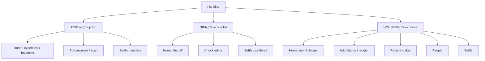

# Split — feature map

Trip cost PWA. One **room** (code + members + ledger) in three kinds: **Trip**, **Bill**, **House**. Host: `split.ailabs.sv`.

This is the product map of what ships. Implementation lives under `src/`. Bank FX calibration is shipped (not a plan).

## Shared

| Feature | What it is |
|---|---|
| Room | Named space with a 6–8 char code, base currency, members, expenses, settlements. `kind` is `TRIP` (default), `DINNER`, or `HOUSEHOLD`. |
| Join | Open by code. Trips/bills: pick or add a name (no account). Houses: signed-in claim (housemate or guest). `?as=Name` / `?claim=` reclaim a seat on a new device. |
| Identity | Seat is a `Member` on the room. Signed-in users can claim a seat (`userId`). Device remembers the last seat in local storage. |
| Auth | Clerk, same app as ailabs.sv. Optional for trips/bills; required to **create a house**, scan receipts, and keep rooms across devices. Combined sign-in/sign-up. |
| Your rooms | Signed-in landing lists owned/claimed rooms. Hide (per user, not delete). Owner can delete. Resume last trip unless `?stay=true`. |
| Invite | Share sheet or copy `/r/$code`. Personal reclaim links are separate. Pending invite survives sign-in. |
| Money | Integer **cents** only. Splits: equal / parts (weights) / exact amounts. Nets + min-transfer settle. Personal expenses: payer-only, out of group settle; others see a redacted row. |
| Pay details | Account number + optional label / savings\|checking. Claimed seats read the signed-in **PayProfile**; unclaimed seats store pay on the member. Never filled from OCR. |
| FX | Room base currency + extra currencies. Mid-market rates from Frankfurter at create; stored on the room. **Bank calibration**: 1–5 samples of (app cents vs bank charge) → shared `fxAdjustmentBps` markup on foreign→base. Recalibrate overwrites. |
| PWA | Installable shell. After a room is opened online, cache + paused `addExpense` mutations persist; they sync on reconnect (header sync icon). Scan needs network. |
| Chrome | Room shell (locked header + tab bar). Tabs: Home · Add/Bill · Settle. Cookie notice docks and shrinks the viewport. Theme toggle. Onboarding splash. |

## Trip (`TRIP`)

Group trip: many expenses, optional multi-currency, anyone in the room can add.

| Surface | Capability |
|---|---|
| `/` create | Name, base currency, extra currencies + live FX, member names. |
| `/r/$code` | Who-are-you gate → balances, sortable expense list, edit/delete (author), personal vs group, pay line, copy code/link, bank FX entry from a foreign expense. |
| `/r/$code/new` | Fast add: title, amount, category chips (Food, Lodging, Transport, Drinks, Activities, Other — free text allowed), payer, split, personal toggle. Optional receipt scan (signed-in) drafts the form. Offline add queues until online. |
| `/r/$code/settle` | “X owes Y $Z”. Record / undo. Optional transfer screenshot. FX footnote + Match bank charges. |

**Not on trips:** recurring, household roles, house receipt photo on the charge, itemized check.

## Bill (`DINNER`)

One restaurant (or similar) check. The room **is** the bill.

| Surface | Capability |
|---|---|
| `/` create | Bill name (becomes merchant), currency, people. |
| `/r/$code` | Who-are-you → bill status, owing, scan ticket, pay line, rename (host). |
| `/r/$code/check` | Itemized editor: lines, qty, modifiers, tax/fee/discount/tip. Per-item split: unassigned, equal, parts, quantity, amount. Draft → confirm (writes one expense + shares) → revert/delete. Precuenta flag from OCR. Host-only edits once a signed-in creator exists; unsigned bills stay open. |
| `/` settle-all | Cross-bill card: pay everyone you owe across recent dinners in one go. |
| `/r/$code/settle` | Same transfer UI as trips, after the bill is confirmed. |

**OCR (bill):** vision draft of items + footer (tax, tip, fees). $0 combo/AYCE rows are dropped (nothing to assign). Duplicate OCR lines that would overshoot the printed total are dropped. Guest count on the ticket is **not** the dining group. Host must be signed in to scan.

**Not on bills:** multi-expense ledger, house months, guests-as-role.

## House (`HOUSEHOLD`)

Ongoing house ledger. Create requires sign-in. Permissions are role-based, not “anyone with the code”.

**Roles:** Owner · Housemate · Moved out · Guest · Visitor.

| Surface | Capability |
|---|---|
| `/` house | Create (signed-in) or land on preferred house. Join: claim unclaimed housemate, join as new housemate, or join/claim as guest. |
| `/r/$code` | Month-grouped charges, due-this-month from templates, hero net, add charge (owner/housemate). Guests cannot add charges. |
| `/r/$code/new` | Charge: title, category (rent, utilities, internet, groceries, supplies, repairs, furniture, subscriptions, other), amount, period month, paid-on, split among people in the house that month. Optional receipt **photo** stored on the charge + OCR draft. |
| `/r/$code/recurring` | Templates: fixed amount or variable (amount at confirm). Due day, start month, split. Confirm / skip / undo skip for a month → expense occurrence. Archive. |
| `/r/$code/people` | Add, rename, guest vs housemate, move-in / move-out dates (stay overlaps month → on the split). Transfer ownership. Can’t delete someone with charges — mark moved out instead. Owner must transfer before moving out. |
| `/r/$code/settle` | House settle UI: record/undo payments with the house permission matrix; optional proof. Row balances by month. |

**Stay:** `joinedOn` / `leftOn` (dates). Someone who has left still sees their ledger (`MOVED_OUT`) but cannot add new charges/templates.

## Receipts

| Mode | Who | What |
|---|---|---|
| Trip scan | Signed-in; not a house; dinner host rules if the room is a bill | Drafts expense title/amount/items into **add expense**. ~1MB, ~45s, `gpt-5-mini`, rate-limited. |
| Bill scan | Same, plus host-only on owned dinners | Drafts the **check** (items, tax, tip, precuenta). |
| House scan | Signed-in housemate/owner | Drafts a **charge**; photo can stay on the expense. Separate vision contract (`scanHouseReceipt`). |

OCR never writes pay account numbers.

## Identity & access (short)

| Kind | Enter | Edit ledger | Scan |
|---|---|---|---|
| Trip | Name on device | Anyone in the room (expense author for edit/delete; recipient or author for settlement delete) | Signed-in |
| Bill | Name on device | Host if the room has an owner; else open | Signed-in host |
| House | Signed-in claim | Role matrix (`house-permissions`) | Signed-in, can add charges |

## Routes

| Path | Kind |
|---|---|
| `/` | Create / join / your rooms / settle-all dinners |
| `/sign-in`, `/sign-up` | Clerk (same combined screen) |
| `/r/$code` | Home (trip list, dinner home, or house home) |
| `/r/$code/new` | Add expense (trip) or charge (house) |
| `/r/$code/settle` | Transfers |
| `/r/$code/check`, `/r/$code/check/$checkId` | Bill editor |
| `/r/$code/people` | House people |
| `/r/$code/recurring` | House templates |

## Product rules that tend to get dropped

1. **Cents, never floats.** Display money through the formatters.
2. **House ≠ trip.** Household writes go through `server/houses.ts`. Do not reuse trip expense APIs for charges.
3. **A dinner is one bill.** Older rows may have extra checks; the first is the bill.
4. **Calibration is trip-scoped and shared.** Markup applies to all foreign→base conversion (home + settle). Not a per-expense bank field. Not a manual % as the primary input.
5. **Pay details are typed by people**, never inferred from a ticket.
6. **Personal expenses** do not move group settle; other members only see that something private exists.
